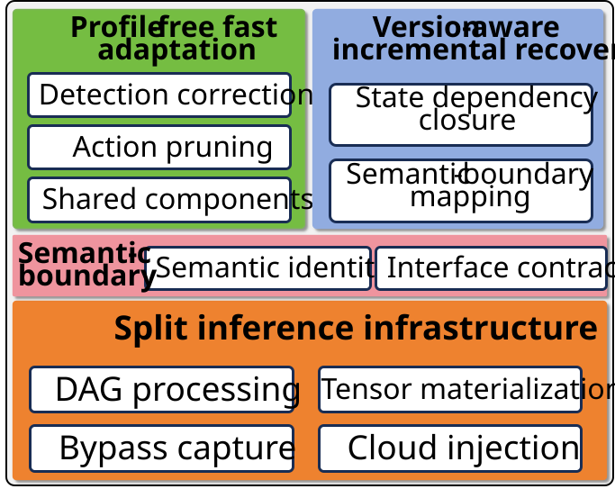

# Evo-Split

Evo-Split is a model-evolution-aware edge-cloud split inference framework for
heterogeneous mobile systems. It combines executable semantic split boundaries,
profile-free online adaptation, training-free activation codecs, and
minimal-impact recovery after model updates.

Evo-Split is a research prototype. The public release focuses on visual DNNs
and an optional MNN-based data plane; it is not a production inference service.



## Highlights

- Complete multi-tensor cut-set construction for DAG models.
- Runtime tensor materialization and cloud-side explicit injection.
- RAW32, FP16, block INT8/INT6/INT4, and LZ4 activation codecs.
- Profile-free split selection with structural pruning, bounded exploration,
  shared component estimation, and online residual correction.
- Version-aware minimal-impact recovery with boundary mapping, dependency
  closure, incremental qualification, and safe commit or rollback.
- C++17/CMake packaging for host, Android, and Linux builds.

## Repository layout

```text
include/                 Public controller, codec, protocol, and update APIs
src/                     Platform-independent implementation
runtime/                 Optional MNN edge/cloud data plane
examples/minimal_demo/   Deterministic profile-free and update-recovery demo
tests/                   Host-independent regression tests
artifact/                Compact processed data and figure reproduction
docs/                    Architecture, build, integration, and demo guides
```

## Quick start

The default build does not require MNN, an Android device, a model, or a
dataset.

```bash
cmake -S . -B build -DEVOSPLIT_WITH_MNN=OFF \
  -DEVOSPLIT_BUILD_TESTS=ON -DEVOSPLIT_BUILD_DEMO=ON
cmake --build build --config Release
ctest --test-dir build -C Release --output-on-failure
```

On Windows, the demo executable is normally located at
`build/Release/evosplit_demo.exe`. On single-configuration generators it is
located at `build/evosplit_demo`.

## Minimal demo

Windows PowerShell:

```powershell
.\examples\minimal_demo\run_demo.ps1
```

Linux:

```bash
bash examples/minimal_demo/run_demo.sh
```

The demo uses the actual C++ profile-free controller and version migration
implementation. It produces a request-level CSV trace and a three-panel figure
showing action adaptation, cumulative regret, and state reuse after a model
update. See [docs/DEMO.md](docs/DEMO.md).

## MNN data plane

MNN is an external dependency and is not vendored. To build real edge/cloud
capture and injection, provide an ABI-compatible MNN library and its headers:

```bash
cmake -S . -B build-mnn \
  -DEVOSPLIT_WITH_MNN=ON \
  -DMNN_INCLUDE_DIR=/path/to/MNN/include \
  -DMNN_LIBRARY=/path/to/libMNN.so \
  -DMNN_SCHEMA_INCLUDE_DIR=/path/to/MNN/schema/current \
  -DFLATBUFFERS_INCLUDE_DIR=/path/to/flatbuffers/include
cmake --build build-mnn --config Release
```

Android builds additionally require the Android NDK toolchain, ABI, API level,
and C++ runtime to match the MNN build. See [docs/BUILD.md](docs/BUILD.md).

## Install and consume

```bash
cmake --install build --prefix /path/to/evosplit-install
```

Downstream CMake projects can then use:

```cmake
find_package(EvoSplit CONFIG REQUIRED)
target_link_libraries(your_target PRIVATE EvoSplit::core)
```

Use `EvoSplit::mnn_runtime` when the optional MNN data plane is enabled. See
[docs/INTEGRATION.md](docs/INTEGRATION.md).

## Paper artifact

The repository intentionally contains only compact processed data. It does not
redistribute model weights, datasets, device binaries, private machine paths,
or raw multi-gigabyte experiment logs. The supplied artifact reproduces a
small set of adaptation, end-to-end, Pareto, and update-recovery plots:

```bash
python -m pip install -r artifact/requirements.txt
python artifact/scripts/verify_artifact.py
python artifact/scripts/reproduce_figures.py --out artifact/generated
```

See [artifact/README.md](artifact/README.md) for provenance and limitations.

## Limitations

- The public artifact is a compact reproducibility subset, not the full raw
  measurement archive.
- Real split inference currently requires MNN and platform-specific builds.
- The public release focuses on visual DNNs; experimental LLM extensions are
  intentionally excluded.
- Public C++ ABI stability is not guaranteed before version 1.0.

## Citation

Citation metadata are provided in [`CITATION.cff`](CITATION.cff). Replace the
repository-level author record with the final paper authors before publication.

## License

Evo-Split is released under the Apache License 2.0. Third-party dependencies,
models, and datasets remain subject to their own licenses.

